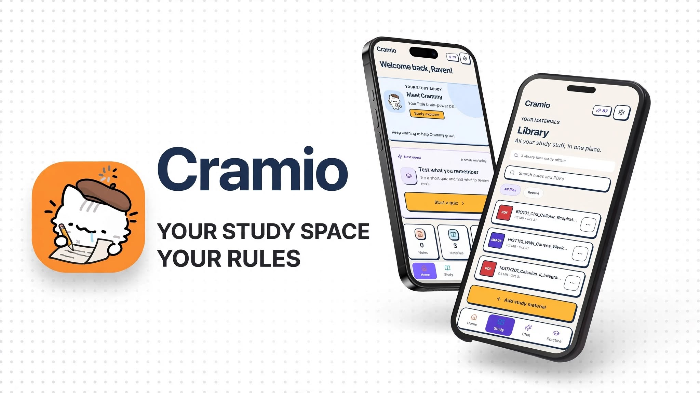

  

  # Cramio

  **Cram less. Learn more.**

  &ensp;
  &ensp;
  

Cramio is the study space that keeps you reading instead of tab-hopping: notes, PDFs, AI study chat, quizzes, and flashcards in one focused place. Open it anywhere: native on Android, in the browser on iPhone and desktop.

## Where to use Cramio

- **[Web app](https://app.cramio.site)** &middot; the real product, right now &middot; any browser on iPhone, iPad, or desktop, same account everywhere
- **[Landing page](https://cramio.site)** &middot; https://cramio.site &middot; public site + Android web-update host
- **Android app** &middot; the native one is Android-first &middot; everyone else: the web app covers you in any browser
